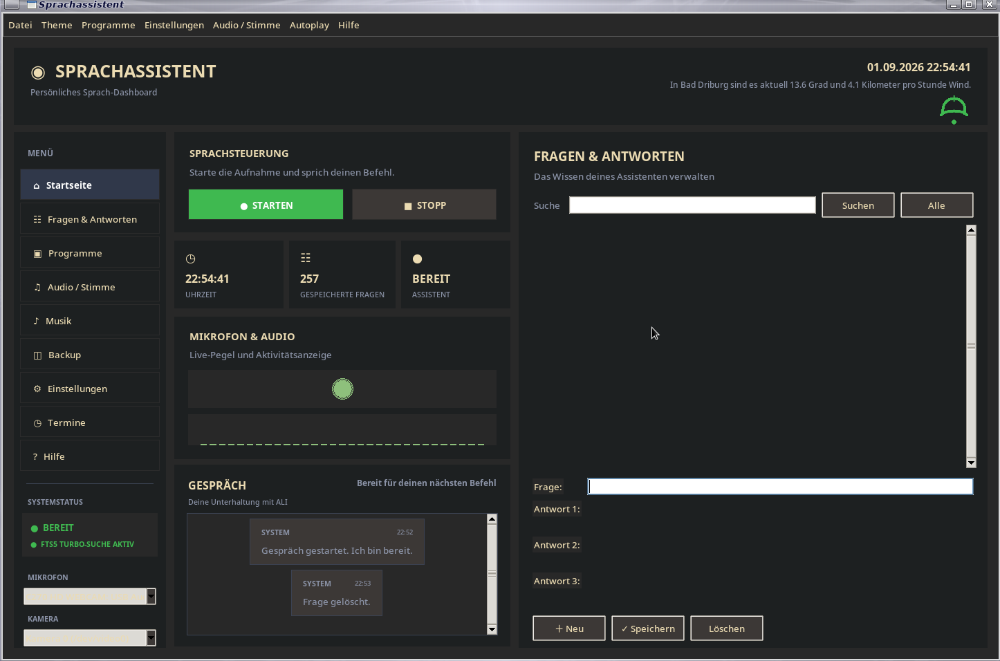

# Sprachassistent v5.3.1

Deutschsprachiger Sprachassistent von Goldisoft.



[Github Seite](https://github.com/Angonikro/Sprachassistent/)

## Funktionen
- Sprachsteuerung und Sprachausgabe
- Chat-/Antwortfenster und gespeicherte Fragen/Antworten
- Websuche
- Terminplaner und Erinnerungen
- Windows-Sprachausgabe über den Windows-Soundtreiber
- Weitere Funktionen des Sprachassistenten
- Wetter abfrage
- Lottozahlen abfragen

## Persönliche Speicherorte
- **Gespeicherte Fragen und Antworten:** `~/.local/share/Sprachassistent/fragen_antworten.db`
- **Erinnerungen und Termine:** `~/.local/share/Sprachassistent/erinnerungen.json`
- **Einstellungen:** `~/.config/Sprachassistent/config.ini`

Die Anwendung verwendet `XDG_DATA_HOME` bzw. `XDG_CONFIG_HOME`, falls diese Umgebungsvariablen gesetzt sind. Vorhandene Datenbank-, Einstellungs- und Erinnerungsdateien aus dem bisherigen Startverzeichnis werden übernommen, sofern am neuen Speicherort noch keine entsprechende Datei existiert. Persönliche Daten liegen damit getrennt vom Programmverzeichnis und bleiben bei Programmupdates erhalten.

## Manuelle Websuche
Über **„Websuche starten“** wird die manuelle Websuche gestartet. Der Assistent fragt nach dem Suchbegriff und verwendet die nächste gesprochene Eingabe als Suchfrage.

## Installation unter Debian 13 / Raspberry Pi OS

### Empfohlene Installation über das DEB-Paket

Das DEB-Paket installiert die Debian-Systemabhängigkeiten automatisch über APT. Dazu gehören:

- Python 3 und Tkinter
- `python3-requests`, `python3-rapidfuzz`, `python3-opencv`, `python3-pil`
- `python3-pyaudio` für den Mikrofonzugriff
- `espeak-ng` für die Sprachausgabe
- `mbrola` und `mbrola-de4` für die verwendete deutsche MBROLA-Stimme `mb-de4`
- `xdg-utils` zum Öffnen von Dateien und Ordnern

Installation:

```bash
sudo apt install ./sprachassistent_5.3.1_all.deb
```

**Wichtig – SpeechRecognition:** Das Python-Modul `SpeechRecognition` wird nicht als Debian-Abhängigkeit mitinstalliert. Es muss separat mit pip für den System-Python installiert werden:

```bash
python3 -m pip install --break-system-packages SpeechRecognition
```

Der Schalter `--break-system-packages` ist unter Debian 13 erforderlich, weil Debian die systemweite pip-Installation standardmäßig durch PEP 668 schützt. Er sollte nur für dieses ausdrücklich gewünschte Zusatzmodul verwendet werden. Falls SpeechRecognition nicht installiert ist, steht die Mikrofon-Spracherkennung nicht zur Verfügung.

### Installation aus dem Quellcode

Zuerst die Systempakete installieren:

```bash
sudo apt update
sudo apt install python3 python3-pip python3-venv python3-tk python3-pyaudio espeak-ng mbrola mbrola-de4 xdg-utils
```

Danach die Python-Pakete installieren:

```bash
python3 -m pip install -r requirements.txt
```

**Hinweis zu Debian 13:** Debian kann die direkte Installation mit `pip` in die systemverwaltete Python-Umgebung blockieren (PEP 668). In diesem Fall eine virtuelle Umgebung verwenden:

```bash
python3 -m venv --system-site-packages .venv
source .venv/bin/activate
python -m pip install --upgrade pip
python -m pip install -r requirements.txt
python Sprachassistent.py
```

`--system-site-packages` macht das über APT installierte `python3-pyaudio` innerhalb der virtuellen Umgebung verfügbar. `SpeechRecognition` wird über pip installiert.

## Abhängigkeiten
Die Python-Abhängigkeiten sind in `requirements.txt` aufgeführt. Für die Sprach- und Audiofunktionen können zusätzlich Systempakete erforderlich sein; deren Verfügbarkeit hängt von Betriebssystem und Distribution ab.

**Version 5.3.1 – By Goldisoft 2026**

73 de DO2QG Andreas
